# HTB Academy Write-up: Information Gathering - Web Edition

**Author:** Nguyen Khac Phat
**Date:** October 09, 2026 
**Platform:** Hack The Box Academy  
**Module:** Network Enumeration with Nmap

## Overview

This document details the methodology and results for the "Network Enumeration with Nmap" module from Hack The Box Academy.In this module we will learn the basics of this tool and how it can be used efficiently to map out the internal network by identifying live hosts and performing port scanning, service enumeration, and operating system detection.

## Tools Used

- `nmap` - Network Mapper


# Exercises

## 1. Host Discovery

### Objective: The objective of host discovery is to identify and characterize the networked devices within a network.

**Q1: Based on the last result, find out which operating system it belongs to. Submit the name of the operating system as result.**


*Look at Time to live (ttl) value*

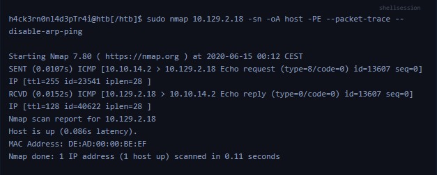

**Answer:** `windows`


## 2. Host and Port Scanning

### Objective: Equip students with network reconnaissance skills and the ability to gather information on target systems.

**Q1: Find all TCP ports on your target. Submit the total number of found TCP ports as the answer.**

```bash
sudo nmap -sS -Pn < IP_Target >
```
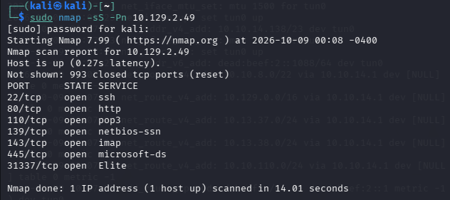

**Answer:** `7`


**Q2: Enumerate the hostname of your target and submit it as the answer. (case-sensitive)**

```bash
sudo nmap -Pn -p22,80,110,139,143,445,31337 -sV < IP_Target >
```
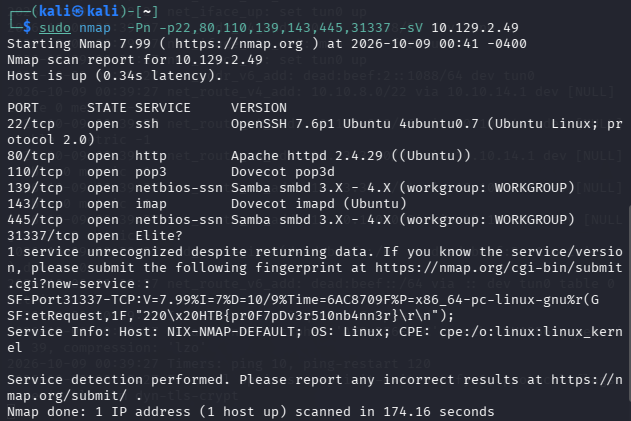
*Look at Service Info: Host:*

**Answer:** `NIX-NMAP-DEFAULT`


## 3. Saving the Results

### Objective: Saving the Results after Nmap scanning.

**Q1: Perform a full TCP port scan on your target and create an HTML report. Submit the number of the highest port as the answer.**

```bash
# We used option -oA to save the results in all formats.
sudo nmap -p- -oA target < IP_Target >
```

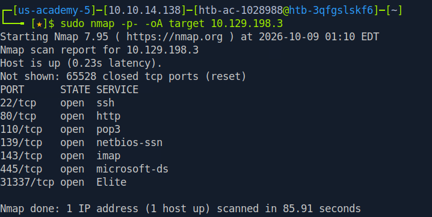
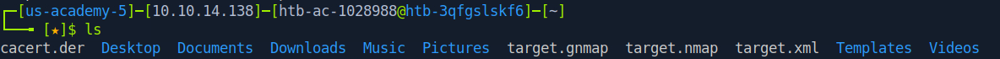

```bash
# Then we converted the results from XML to formatl HTML.
xsltproc target.xml -o target.html
```

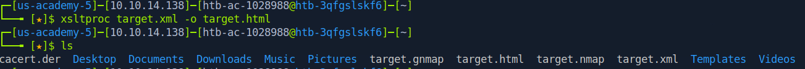

*Finally we open file on browser*
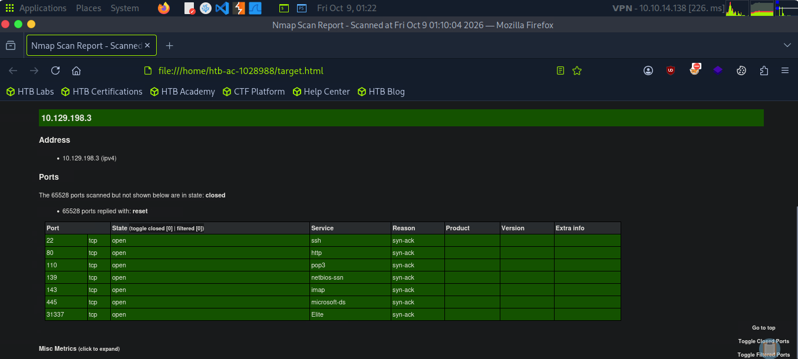

**Answer:** `31337`


## 4. Service Enumeration

### Objective: Determine the application and its version .

**Q1: Enumerate all ports and their services. One of the services contains the flag you have to submit as the answer.**

```bash
sudo nmap -sV -sC --top-ports 1000 < IP_Target >
```
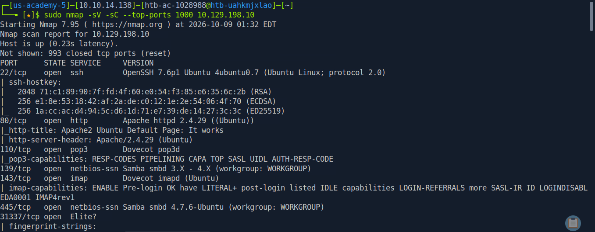
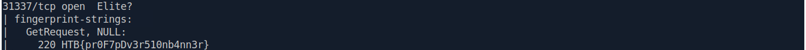

**Answer:** `HTB{pr0F7pDv3r510nb4nn3r}`


## 5. Nmap Scripting Engine

### Objective: The extensibility of the Nmap tool—beyond port scanning and host discovery—facilitates the automation and execution of complex tasks in network analysis and security.

**Q1: Use NSE and its scripts to find the flag that one of the services contain and submit it as the answer.**  

```bash
sudo nmap -sV --script vuln  -p80 < IP_Target >
```

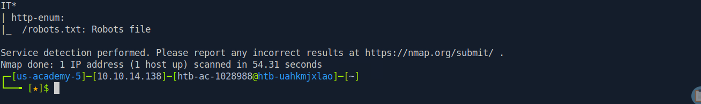
*We found a file robots.txt,let's visited this site on browser*

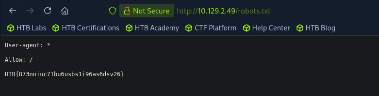

**Answer:** `HTB{873nniuc71bu6usbs1i96as6dsv26}`


## 6. Firewall and IDS/IPS Evasion - Easy Lab

### Information: Practice using Nmap to Enumeration.

**Q1: Our client wants to know if we can identify which operating system their provided machine is running on. Submit the OS name as the answer.**


```bash
# To find OS name, we use option -sV or -A.
sudo nmap -sV -p22,80,10001 < IP_Target >
```
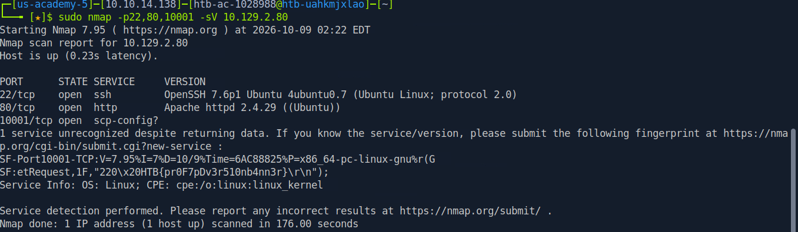

**Answer:** `ubuntu`


## 7. Firewall and IDS/IPS Evasion - Medium Lab

### Information: Practice using Nmap to Enumeration.

**Q1: After the configurations are transferred to the system, our client wants to know if it is possible to find out our target's DNS server version. Submit the DNS server version of the target as the answer.**

*First, we need to find which TCP ports are open on the target*

```bash
sudo nmap -sS --top-ports 1000 -T 4 < IP_Target >
```
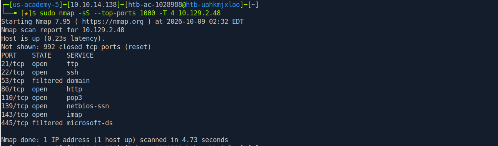
*We see the DNS server is running on port 53, but port 53 TCP is filtered, we switch to a UDP scan with option -sU*

```bash
sudo nmap -sU -p53 -sV < IP_Target >
```
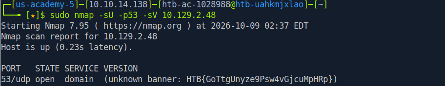

**Answer:** `HTB{GoTtgUnyze9Psw4vGjcuMpHRp}`


## 8. Firewall and IDS/IPS Evasion - Hard Lab

### Information: Practice using Nmap to Enumeration.

**Q1:Now our client wants to know if it is possible to find out the version of the running services. Identify the version of service our client was talking about and submit the flag as the answer.**  

*First, we need to find which TCP ports are open on the target* 

```bash
sudo nmap -sS --top-ports 1000 -T 4 < IP_Target >
```
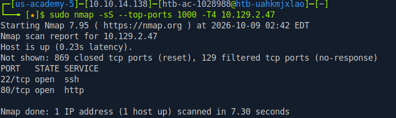
*We only found two open ports: 22 and 80, a firewall may have detected our scan. So we used --source-port 53 to bypass it.* 

```bash
sudo nmap -sS --source-port 53 --top-ports 1000 -T 4 < IP_Target >
```
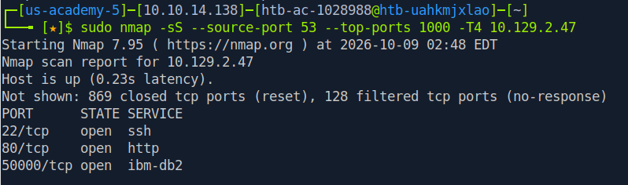
*We found another open port.Let's use ncat with --source-port 53 to connect to it.* 

```bash
sudo ncat -nv --source-port 53 < IP_Target > < Port >
```
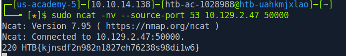

**Answer:** `HTB{kjnsdf2n982n1827eh76238s98di1w6}`


## Module Key Takeaways

- A strong grasp of key techniques for network enumeration using Nmap
- Host discovery, port scanning, service enumeration, and operating    system detection
- Working with saved Nmap scan results
- Evading network defenses to obtain accurate scanning results