# HTB Academy Write-up: Footprinting

**Author:** Nguyen Khac Phat
**Date:** October 09, 2026 
**Platform:** Hack The Box Academy  
**Module:** Footprinting

## Overview

This document details the methodology and results for the "Network Enumeration with Nmap" module from Hack The Box Academy.Module Footprinting covered many manual techniques that we can use for manual enumeration, footprinting, and interaction with a wide variety of services.

## Tools Used

- `nmap` - Network Mapper
- `netcat` 
- `smbclient` - Interaction with SMB service
- `rpcclient` - Interaction with SMB service

# Exercises

## 1. FTP

**Q1: Which version of the FTP server is running on the target system? Submit the entire banner as the answer.**

*We used ncat to connect to FTP*
```bash
sudo ncat -nv < IP_Target > < Port >
```

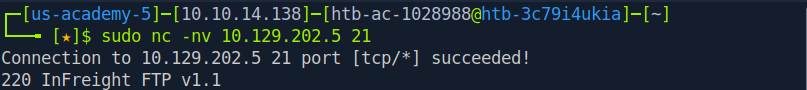

**Answer:** `220 InFreight FTP v1.1`

**Q2: Enumerate the FTP server and find the flag.txt file. Submit the contents of it as the answer.**

*We tried to login with Anonymous*
```bash
ftp < IP_Target > 21
```
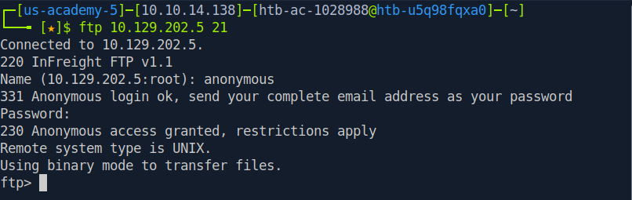

*We used ls to list directory and file*
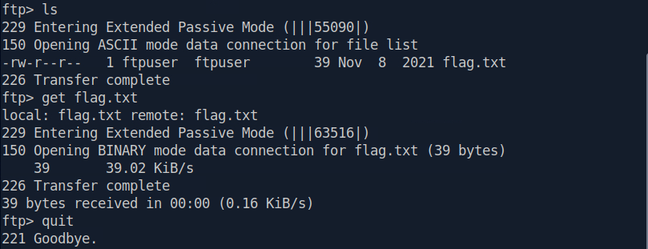
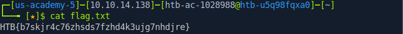

**Answer:** `HTB{b7skjr4c76zhsds7fzhd4k3ujg7nhdjre}`


## 2. SMB

**Q1: What version of the SMB server is running on the target system? Submit the entire banner as the answer.**

```bash
sudo nmap -sC -sV -p139,445 < IP_Target >
```
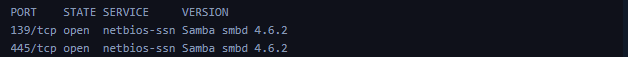

**Answer:** `Samba smbd 4.6.2`


**Q2: What is the name of the accessible share on the target?**

```bash
smbclient -N -L \\\\< IP_Target >
```
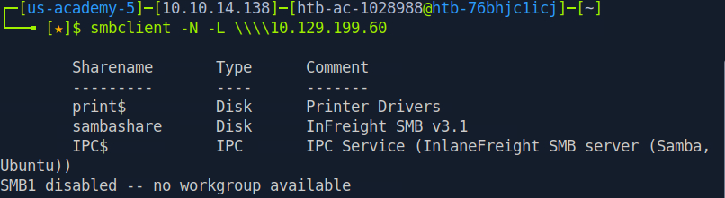

**Answer:** `sambashare`


**Q3: Connect to the discovered share and find the flag.txt file. Submit the contents as the answer.**

*In Q2, we discovered a share named 'sambashare'.*
```bash
smbclient -N -L \\\\< IP_Target >\\sambashare
```
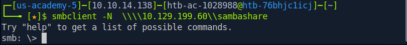
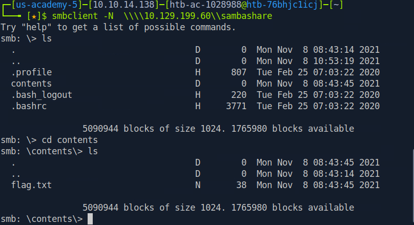
*After some basic enumeration, we located flag.txt. Now, we just need to download and read it on our attack box.*
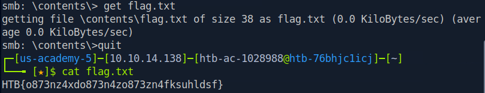

**Answer:** `HTB{o873nz4xdo873n4zo873zn4fksuhldsf}`


**Q4: Find out which domain the server belongs to.**

*We used rpcclient to interactive with target (password is NULL)*
```bash
rpcclient -U "" < IP_Target >
```
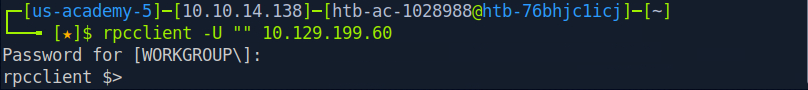

*After a successful connection, we used 'querydominfo' to find the information.*
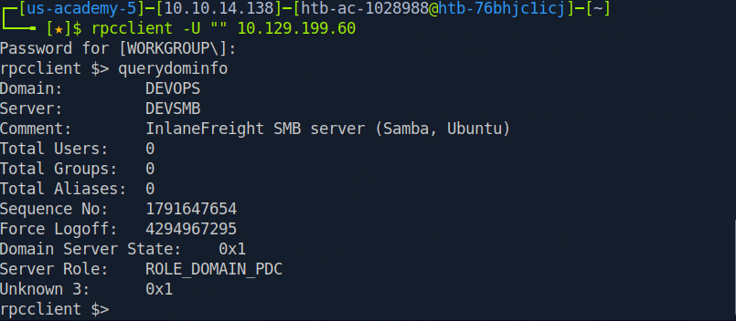

**Answer:** `DEVOPS`


**Q5: Find additional information about the specific share we found previously and submit the customized version of that specific share as the answer.**

```bash
smbclient -N -L \\\\< IP_Target >\\sambashare
```


**Answer:** `InFreight SMB v3.1`


**Q6: What is the full system path of that specific share? (format: "/directory/names")**

*We used rpcclient to interactive with target (password is NULL)*
```bash
rpcclient -U "" < IP_Target >
```


*After a successful connection, we used 'netsharegetinfo sambashare' to find the information.*
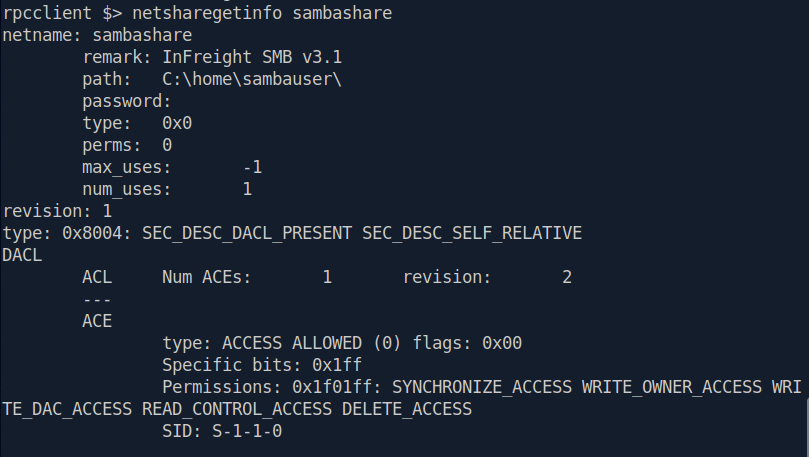

**Answer:** `/home/sambauser/`